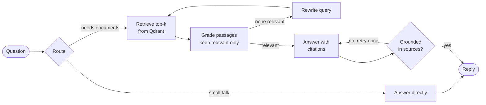

# 🧭 DocPilot: Agentic RAG with LangGraph + Qdrant


Ask questions about your own PDFs and notes. Unlike plain "retrieve and answer" RAG, DocPilot is an **agent**: it decides whether it needs to search, throws away irrelevant passages, rewrites the search when it finds nothing useful, answers with **citations**, and **checks its own answer** against the sources before replying.

## How the agent works



| Step | Why it matters |
|---|---|
| **Route** | Greetings don't trigger a search. A deterministic rule, not an LLM: see the benchmark below for why |
| **Grade** | The LLM drops retrieved chunks that don't help, so the answer isn't distracted by noise |
| **Rewrite** | Vague questions ("WFH allowance?") get expanded into better queries, up to 2 retries |
| **Cite** | Every claim points to `[n]`, a numbered source with file and page |
| **Self-check** | A second LLM pass flags unsupported claims and forces one stricter rewrite |
| **Abstain** | If nothing relevant is found, it says so instead of guessing |

## Stack

LangGraph (agent graph) · Qdrant (vector DB, local or cloud) · FastEmbed `bge-small-en-v1.5` (local embeddings, no API key) · Groq / OpenAI / Ollama (LLM, configurable) · FastAPI (REST API) · Streamlit (chat UI) · pytest + GitHub Actions (offline tests)

## Results

### Benchmark: SQuAD 2.0, plain RAG vs DocPilot

[`eval/squad_bench.py`](eval/squad_bench.py) builds a corpus from every paragraph of 8 Wikipedia articles in the SQuAD 2.0 dev set (294 paragraphs) and asks 60 questions: 36 answerable and **24 unanswerable ones written to look answerable**. Both systems use the same retriever, top-k, answer model (`qwen/qwen3.8-27b` on Groq) and answer prompt; `openai/gpt-oss-120b` judges every answer against the official SQuAD answers. Run it yourself with [`benchmark_colab.ipynb`](benchmark_colab.ipynb).

**Run 1 (with an LLM router), 25 Nov 2026:**

| | Plain RAG | DocPilot |
|---|---|---|
| Answerable: correct | **94.4%** | 86.1% |
| Unanswerable: correctly says "not found" | 66.7% | 66.7% |
| Overall accuracy | **83.3%** | 78.3% |
| Avg latency | 7.5 s | 11.8 s |
| LLM calls / question | 1.0 | 3.9 |
| Tokens / question | 1,002 | 1,549 |

**DocPilot lost.** Reading the 11 questions where the two systems disagreed showed why:

- **6 of DocPilot's 7 losses came from the router.** It labelled factual questions ("What is the largest university press in the U.S.?") as general knowledge and answered them without searching the documents, and the model then answered from memory.
- **Where it did retrieve, the agent was better at saying "not found":** it correctly declined 3 trick questions that plain RAG answered with made-up facts.
- 1 loss was over-caution: the grader dropped the passage that held the answer.

**Fix:** routing is now a deterministic small-talk rule (greetings, thanks, "what can you do?"); every real question goes through retrieval and grading. This also removes one LLM call per question. Regression tests cover the misrouted questions.

**Run 2 (fixed router), 26 Nov 2026**, same questions, models and settings ([raw results](eval/squad_results_run2_rule_router.json)):

| | Plain RAG | DocPilot |
|---|---|---|
| Answerable: correct | **94.4%** | 91.7% |
| Unanswerable: correctly says "not found" | 66.7% | **70.8%** |
| Overall accuracy | 83.3% | 83.3% |
| Avg latency | 7.8 s | 13.7 s |
| LLM calls / question | 1.0 | 3.3 |
| Tokens / question | 1,002 | 1,794 |

The fix closed the gap: DocPilot went from 78.3% to 83.3% and now ties plain RAG overall. The two systems disagreed on 6 questions, split 3–3:

- DocPilot won by declining 2 trick questions that plain RAG answered with made-up details (e.g. "how much steam did Watt's engine use?", where the source only mentions coal), plus 1 answerable question.
- It lost by being over-cautious twice (the grader dropped the passage holding the answer) and by answering 1 trick question that plain RAG declined.
- Two of the six verdicts are borderline calls by the LLM judge, so at 60 questions treat a difference of 1–2 questions as noise.

Takeaway: with a strong model and clean single-paragraph answers, plain RAG is a hard baseline. DocPilot's grading and grounding steps make it slightly safer on unanswerable questions, but at 3.3x the LLM calls and 1.8x the latency, so it earns its cost only where a wrong answer is expensive. Next: multi-hop questions and noisier documents, where query rewriting should matter more.

## Quick start

```bash
git clone https://github.com/khush-ahuja/DocPilot.git
cd DocPilot
pip install -r requirements.txt
cp .env.example .env        # add your GROQ_API_KEY (from console.groq.com)

python ingest.py sample_docs/          # index the sample documents
streamlit run app.py                   # chat UI at localhost:8501
uvicorn api:app --reload               # or the REST API at localhost:8000/docs
python eval/run_eval.py                # benchmark plain RAG vs the agent
```

Want it fully local? Set `LLM_PROVIDER=ollama` and `LLM_MODEL=llama3.1` and run Ollama, so no data leaves your machine.

### API

```bash
curl -F "files=@handbook.pdf" localhost:8000/ingest
curl -H "Content-Type: application/json" \
     -d '{"question": "How many leave days can I carry over?"}' localhost:8000/ask
```

The response contains `answer`, `sources` (file, page, score, text), `grounded`, `rewrites` and an agent `trace`.

## Project structure

```
docpilot/
  graph.py       LangGraph agent: route, retrieve, grade, rewrite, generate, self-check
  store.py       Qdrant wrapper (idempotent upserts, delete by source, search)
  ingest.py      PDF/Markdown/text loading and paragraph-aware chunking
  embeddings.py  FastEmbed backend (plus a hashing embedder for tests)
  prompts.py     all prompts in one place
  llm.py         Groq / OpenAI / Ollama factory, robust JSON parsing
api.py           FastAPI service
app.py           Streamlit chat UI with sources and agent trace
ingest.py        command-line indexing
eval/            QA set and plain-RAG vs agent benchmark
tests/           offline tests using a scripted fake LLM (no API key needed)
```

## Tests

```bash
pytest -q
```

The tests run without any API key or model download. They cover chunking, idempotent indexing, citations, routing, the rewrite loop, clean abstention, the grounding retry and the API.

## Ideas for next steps

- Hybrid search (BM25 + dense) and a cross-encoder reranker
- Conversation memory for follow-up questions
- Streaming responses
